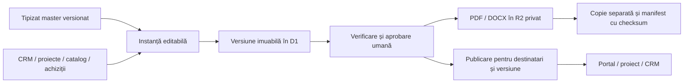

# AVYRON OS — Document Center

Stare: release autorizat pentru producție la 4 noiembrie 2026. Verificările locale și CI sunt trecute; rezultatul migrării și revizia efectiv servită trebuie confirmate în jurnalul release-ului. Nu s-au trimis documente reale către destinatari externi.

## Structură și arhitectură

Categoria **Documente** este în meniul central, după Produse AVYRON și înainte de Activitate. Are cinci zone: Bibliotecă, Tipizate și generator, Documente staff, Documents Hub și Documentele firmei. Ofertele, documentele clienților, documentele independente și arhiva sunt filtre în Bibliotecă. Zona firmei este eliminată din navigare, rezultate, căutare, numărători și acces direct pentru utilizatorii neautorizați.

React/Tiptap folosește API-ul Hono existent, autentificarea `cfAuth`, rolurile și capabilitățile D1 existente. Nu se introduc autentificare, CRM, produse ori abonamente paralele și nu se adaugă Supabase. Editorul și generatorul sunt încărcate la cerere; bibliotecile PDF/Word rulează în Worker și nu sunt descărcate de paginile publice.

Exporturile noi sunt randate prin RPC în `DocumentExportRuntime`, separat de runtime-ul agenților AI. Contul Workers Free are un buget CPU mai mic decât cel necesar randării; runtime-ul Durable Object folosește infrastructura Cloudflare existentă, fără upgrade de plan. Un obiect per versiune/format/stare de aprobare coordonează randările simultane. Conținutul nu este persistat în obiect și nu este expus prin HTTP; API-ul verifică accesul înaintea apelului și din nou înaintea descărcării. Exporturile existente sunt reutilizate direct din R2. Lipsa bindingului produce o eroare explicită, fără fallback costisitor în Workerul HTTP. Referințe: [limite Workers](https://developers.cloudflare.com/workers/platform/limits/), [limite Durable Objects](https://developers.cloudflare.com/durable-objects/platform/limits/).

Migrația `0075_document_center.sql` adaugă metadate, modele, versiuni, politici, granturi, destinatari pe versiune, asocieri tipizate, aprobări, fișiere, distribuiri, audit, backupuri și extensii ale fișei juridice existente. Singura extindere a tabelului de servicii este `catalog_code_id`, nullable. Migrația `0076_document_template_families.sql` introduce cele 11 familii; generatorul de seed este `scripts/documents/generate-seeds.mjs`. Nu se șterg și nu se rescriu datele vechi.

Asocierile folosesc FK către client, proiect, instanță de serviciu, abonament de mentenanță, abonament de facturare, produs, comandă, drept de acces/licență, partener existent în CRM și catalog comercial. Aceeași înregistrare centrală este afișată în toate contextele. Un document nu poate reuni proiecte ale beneficiarilor diferiți.

## Ecrane și API

| Ecran / rută | Comportament |
| --- | --- |
| `/profil?tab=documents` | Bibliotecă privată, căutare autorizată, filtre, sortare, paginare, arhivă |
| `&document=<id>&version=<id>` | Editor sau versiune publicată autorizată, export, preview real PDF și istoric |
| Generator, în aceeași categorie | Context → recomandări → date → personalizare → verificare → creare |
| Documente staff | Cele **8** ghiduri găsite efectiv în repository; textul este servit exclusiv prin API pentru staff |
| Documents Hub | Colecție distinctă și import explicit al înregistrărilor legacy; originalele rămân intacte |
| Documentele firmei | Bibliotecă exclusiv pentru proprietarii autorizați |
| Fișa proiectului | Secțiunea „Documentele proiectului”, cu aceleași înregistrări și permisiuni |
| CRM / administrare abonamente | Legături către biblioteca filtrată după client sau abonament |

Căutarea în conținut folosește FTS5 pe versiuni, cu normalizarea diacriticelor și query-uri construite din termeni citați. Același filtru de autorizare este aplicat rezultatelor și numărătorilor; fragmentele din alte documente nu sunt returnate.

API-ul este sub `/api/documents`, protejat și pe calea exactă, și pe subrute. Include `bootstrap`, `context`, `staff-guides`, `legacy-hub`, `notices`, CRUD de versiuni, `approve`, `publish`, `access`, `assignments`, `archive`, `duplicate`, `save-template`, gestionarea versiunilor/revizuirii modelelor, profiluri de servicii, date juridice, `import`, descărcări, `export/pdf`, `export/docx`, `share`, `backups` și restaurare. `project-backups` procesează câte cinci documente, cu cursor, fără a depăși scope-ul proiectului.

## Modele și generator

Sunt redactate în română: Brief universal; Audit și evaluare; Ofertă comercială și deviz; Contract-cadru; Anexă de servicii; Acord de acces și administrare; Confidențialitate și protecția datelor; Plan de implementare; Raport universal; Proces-verbal de recepție și predare; Acord mentenanță/SLA.

Modelele conțin articole, definiții, responsabilități, limite și câmpuri delimitate. Nu sunt aprobări juridice. Modelele juridice pornesc în `review_required`; aprobarea unui document juridic necesită atât revizuirea masterului, cât și o referință de revizuire pentru versiunea documentului. Relațiile de parteneriat trebuie delimitate și revizuite pentru situația concretă. DPA este inclus numai când operatorul selectează expres modul DPA; nu este atașat oricărui contract. Referința pentru revizuirea acestei variante este [articolul 28 din Regulamentul (UE) 2016/679](https://eur-lex.europa.eu/eli/reg/2016/679/2016-05-04?locale=ro).

Generatorul permite selecție multiplă de modele, clienți și proiecte noi prin API-urile CRM existente, proiecte multiple ale aceluiași beneficiar, servicii și abonamente concrete, catalog, produse, achiziții și licențe. În cazul achizițiilor, numai conturile atribuite neechivoc unui singur beneficiar sunt preluate. Pentru conturi legate de mai multe firme este necesară o mapare juridică explicită, înainte de asociere.

Catalogul intern este sursa prețurilor și identificatorilor. Serviciile publice sunt folosite pentru reconciliere, fără a inventa înregistrări ori prețuri. Profilurile de documente pot fi adaptate din aceeași zonă: câmpuri, livrabile și modele recomandate pe identificator de catalog. Serviciile noi au un profil generic explicit până la configurare. Recomandările sunt contextuale și nu aprobă sau trimit documente automat.

Modelele propuse din documente personalizate rămân private și urmează accesul curent la documentul sursă, inclusiv revocarea. Valorile dinamice cunoscute sunt transformate în variabile goale, iar devizul clientului este eliminat din propunere. Revizuirea este obligatorie înainte de reutilizarea unei asemenea propuneri; nu este publicată automat tuturor membrilor staff. Documentele firmei nu pot fi propuse ca modele comune.

Ofertele păstrează prețul de catalog și prețul curent, motivul modificării, moneda, taxele și recurența. Backendul respinge metadate de catalog falsificate. Valorile fiscale neverificate și prețurile „la ofertare” neconfirmate blochează aprobarea. Nu sunt schimbate prețurile globale. Licențele nu primesc drepturi suplimentare prin generarea documentului.

## Editor și export

Editorul folosește un AST validat, fără HTML arbitrar, linkuri active, scripturi sau embeduri. HTML-ul copiat este sanitizat înainte de inserarea în editor; imaginile și elementele de urmărire nu ocolesc carantina prin clipboard sau drag-and-drop. Numele fișierelor importate sunt transmise în antetul existent `X-File-Name`, fără date personale în URL. Include titluri, liste, tabele, page-break, formatare, antet/subsol, variabile, deviz editabil, zoom și preview A4 adaptat ecranului. Previzualizarea PDF deschide fișierul real într-un blob local autentificat.

Autosave serializează cererile și păstrează același idempotency key la retry. Un conflict de revizie nu suprascrie lucrul altui operator. Navigarea între secțiunile dashboardului încearcă salvarea; în caz de eroare editorul păstrează textul și oferă o copie locală privată. Versiunile sunt imuabile; editarea și restaurarea emit versiuni noi. Editarea masterului este o acțiune separată. Modificarea masterului nu rescrie documentele existente.

PDF este generat cu pdfmake și Roboto cu diacritice românești; DOCX este OOXML real, editabil, generat cu `docx`. Ambele includ sigla AVYRON, antet/subsol, numerotare și tabele. Ciornele au marcaj distinct. Exportul aprobat este separat de cache-ul ciornei. Numele fișierelor nu conțin numele clientului. Un index unic previne păstrarea mai multor exporturi concurente pentru aceeași versiune și stare.

Imaginile importate rămân în carantină până la o scanare reală. Nicio imagine data URI introdusă direct nu ocolește acest control. Nu există un scanner configurat sau o aprobare manuală care să mimeze scanarea.

## Securitate și distribuire

- Conturile și rolurile sunt revalidate din D1; JWT-ul nu constituie sursă de privilegii. Conturile nominalizate folosesc rolurile existente. O identitate rezervată fără cont înregistrat trebuie activată prin fluxul existent de onboarding, fără creare automată de identitate.
- Owner are acces la zona firmei. Un Super Admin primește această zonă numai dacă are și capabilitatea globală activă `documents.company.owner`. Admin/Staff nu o moștenesc.
- Citirea, crearea, editarea, ștergerea logică/arhivarea, exportul, partajarea, aprobarea, publicarea, administrarea modelelor și backupurile sunt capabilități distincte. Accesul de citire nu autorizează distribuirea.
- Clientul are nevoie de grant activ, apartenență curentă la beneficiar și publicare explicită pentru versiunea curentă. Istoricul este filtrat și după destinatarul fiecărei versiuni. Republicarea pentru alt destinatar nu acordă acces la versiunile anterioare și nu păstrează automat vechiul destinatar pe noua versiune.
- Verificările acoperă listare, căutare, numărători, URL direct, versiuni, fișiere, export, notificări și distribuire. Accesul este revalidat înainte de pornirea descărcării. Răspunsurile private folosesc `private, no-store`, `nosniff` și `noindex`.
- Politica MFA existentă este respectată și la citiri privilegiate; implementarea nu activează și nu slăbește configurația MFA a platformei.
- Importurile au tip/extensie/semnătură și limită de 15 MiB; rămân în carantină și nu pot fi descărcate până la scanare. Nu sunt indexate în AI și nu sunt trimise către modele externe.
- Rate limiting, idempotency keys, CAS pe revizie, FK, triggeri de imuabilitate și audit sunt aplicate în backend. Feedul existent de notificări operaționale aplică și el filtrul Document Center, astfel încât pierderea accesului corporativ să nu lase notificări private vizibile. Rutele existente de media/finanțe folosesc propriile înregistrări și nu acceptă chei arbitrare Document Center.

Distribuirea cere confirmarea versiunii, canalului și unui destinatar verificat. Linkul implicit este către contul autentificat din `app.avyron.ro`; nu se generează URL public R2 sau link anonim. Atașamentul extern necesită și politica documentului, și confirmare separată.

| Canal | Stare implementată |
| --- | --- |
| Link privat | Pregătire și copiere, fără a acorda acces persoanei care primește linkul |
| AVYRON OS | Notificare internă deduplicată pentru destinatarul autorizat |
| E-mail | Adaptor către furnizorul existent; ID-ul furnizorului este păstrat când există. `sent` înseamnă acceptare pentru transmitere, nu confirmarea livrării în inbox |
| WhatsApp | Partajare manuală cu mesaj și link privat; deschiderea aplicației rămâne `prepared` |
| Telegram | Partajare manuală; nu se pretinde existența unui bot de expediere |

Lipsa configurației e-mail este `failed/email_unconfigured`. O întrerupere după apelul furnizorului este `unknown`, fără retry automat al trimiterii. Un apel rămas `sending` este trecut în `unknown` după cinci minute de către curățarea programată. Nu există webhook de confirmare a livrării implementat pentru acest modul.

## Stocare, retenție și restaurare

Fișierele sunt sub chei opace `documents/<id>/...`, în bindingul existent `FILES`. Metadatele și conținutul editabil/versionat sunt în D1. Exporturile sunt generate la cerere și reutilizate pentru aceeași versiune/stare; ciornele exportate expiră după o zi. Exporturile oficiale, importurile, aprobările, istoricul și documentele arhivate nu au o regulă generală de ștergere.

**Activare fail-closed:** operațiile pe fișiere necesită `DOCUMENT_STORAGE_PRIVACY_VERIFIED=true`. La 4 noiembrie 2026, verificarea directă în dashboardul Cloudflare Avyron a confirmat că `avyron-files` nu are domeniu public și are `r2.dev` dezactivat. Flagul este activat explicit în configurația de producție. CLI-ul nu are scope R2 de administrare; verificarea s-a făcut în sesiunea existentă Cloudflare, fără emiterea unui token nou.

Backupurile folosesc bindingurile distincte `DOCUMENT_BACKUPS` → `avyron-document-backups` și `DOCUMENT_COMPANY_BACKUPS` → `avyron-company-document-backups`, plus `DOCUMENT_BACKUP_ISOLATION_VERIFIED=true`. Destinațiile au fost create în serviciul R2 existent, în clasa Standard, cu acces public dezactivat, fără abonament sau serviciu nou. Nu au fallback la bucketul primar și nu sunt moștenite de mediul preview. Nu s-au activat joburi automate de backup sau reguli de ștergere.

Un backup face o copie separată a fiecărui fișier permanent, verifică SHA-256 înainte și după copiere și salvează manifestul cu versiuni, tipizatul folosit, asocieri, politici, granturi, destinatari pe versiune, aprobări, distribuiri și audit. Citirile de metadate sunt într-un batch D1 tranzacțional; schimbarea reviziei pe durata copiei invalidează backupul. Manifestul este recitit și verificat înainte de `verified`. Copiile parțiale ale unui backup eșuat sunt eliminate fără a șterge originale sau backupuri deja verificate; o eroare de curățare este înregistrată distinct.

Restaurarea individuală verifică manifestul, beneficiarul și fiecare obiect, scrie chei noi și creează o **ciornă nouă**. Nu reactivează granturi revocate, nu republică și nu suprascrie versiuni istorice. Exporturile vechi restaurate sunt atașamente istorice și nu sunt reutilizate ca export al versiunii noi. La conflict sau eroare, obiectele noi neînregistrate sunt eliminate.

Backupul unui proiect este disponibil în loturi limitate din fișa proiectului. Restaurarea unui proiect se face controlat, document cu document, din biblioteca filtrată a proiectului. Pentru pierderea integrală a D1 este necesară întâi restaurarea bazei de date prin procedura existentă, apoi reconcilierea manifestelor și a obiectelor; acest modul nu înlocuiește procedura de disaster recovery a platformei.

Limite inițiale: 500 KB conținut/versiune, 5.000 noduri, 12 niveluri, 50 linii de deviz, 15 MiB/fișier, cel mult 100 fișiere permanente și manifest sub 8 MiB într-un backup individual. Depășirile eșuează explicit și necesită procesare asistată pe loturi. Backupurile nu expiră automat; politica de retenție pe categorii și programarea automată trebuie aprobate/configurate înainte de utilizarea live. Nu se revendică backup continuu al documentelor în producție.

## Audit inițial și reconciliere

Au fost inspectate repository-ul, site-urile publice, configurația Worker și datele D1 autorizate. Inventarul operațional datat este păstrat separat de repository-ul public. Generarea folosește datele existente; nu se introduc clienți, proiecte, abonamente, drepturi sau valori comerciale fictive.

Repository-ul conține 8 ghiduri staff, deși cerința menționa 9; ele sunt păstrate fără a inventa al nouălea document. Ghidurile istorice nu devin sursă de prețuri pentru ofertare. Hubul legacy este importat numai prin acțiune explicită, fără modificarea originalelor.

## Verificare și limite de livrare

Testele de integrare folosesc handler-ele reale Hono, toate migrațiile aplicate în SQLite și stocare simulată pentru erori controlate. Verificările separate pe `wrangler dev --local` folosesc D1 și R2 locale, conturi și date sintetice. Nicio adresă de test nu este folosită la expediere reală.

Sunt acoperite izolarea A/B, rolurile firmei, revocarea, destinatarii pe versiune, URL-uri directe, mastere imuabile, idempotency/CAS, identități PF/PJ/PFA/ONG, proiecte multiple, catalog, licențe fără beneficiar ambiguu, carantina, e-mail indisponibil și furnizor simulat, backup cu integritate/restaurare, limitele editorului și PDF/DOCX autentice cu mai multe pagini. Interfața este verificată în browser pe desktop și viewport de telefon; acestea nu sunt teste pe dispozitive Android/iOS fizice.

Limitări explicite: scanare malware și inserare de imagini importate inactive; niciun mesaj extern real de probă; fără confirmare inbox/webhook; fără integrare automată WhatsApp/Telegram; fără AI pe documente private; fără generare automată pornită de toate evenimentele de lead/proiect/abonament; fără retenție automată configurată pe categorii sau restaurare atomică de proiect; datele fiscale și modelele juridice necesită completare/revizuire. Selecția contextuală inițială este limitată la 250 de clienți și 500 de proiecte/instanțe; extinderea la volume mai mari necesită căutare server-side dedicată în generator.

Înainte de migrare s-au salvat privat bookmarkul D1 și exportul celor 210 tabele nevirtuale, restaurat local cu integritate `ok` și zero încălcări FK. Exportul integral standard D1 refuză baza cu FTS5; indexurile virtuale reconstruibile sunt inventariate separat, iar bookmarkul Time Travel rămâne punctul pentru recuperarea integrală. Singurul obiect R2 existent a fost descărcat într-o copie locală privată. Artefactele și URL-urile temporare de export nu se publică în Git.

Reverificarea pentru release a inclus și reconstruirea ambelor indexuri FTS în copia D1 restaurată, cu interogări funcționale; editare în browser și păstrarea după reload; descărcare PDF și DOCX prin butoanele reale; upload prin selectorul de fișiere și afișarea carantinei. Fluxul Worker/D1/R2 local a fost repetat după mutarea randării în runtime-ul RPC, inclusiv backup și restaurare.

## Ordinea de activare, numai după aprobarea release-ului

1. Revalidare `origin/main`, CI, identitatea contului Cloudflare și destinația exactă. Backup D1 și inventar/copiere R2 înainte de migrare.
2. Aplicare incrementală a migrațiilor 0075 și 0076 prin fluxul aprobat. Verificare FK/integritate și a datelor vechi; publicarea codului fără migrații produce o eroare recuperabilă, fără inventarea de date.
3. Verificare privatizare `FILES`, apoi setare explicită a flagului de confidențialitate. Verificare bucketuri separate și acces owner, apoi activare backup prin flagul distinct, în bugetul aprobat.
4. Completare date juridice reale, fiscalitate și revizuirea modelelor; verificare onboarding Anișoara și capabilități Super Admin. Politica MFA se decide în configurația platformei, separat.
5. Smoke test cu două conturi autorizate de probă: generare → editare → aprobare → export → publicare → revocare → backup → restaurare. Orice e-mail real de test se trimite numai către destinatarul aprobat.
6. Merge/deploy prin fluxul existent, urmate de verificarea independentă a reviziei live și a funcțiilor activate. Fără modificări în Lovable în paralel.

Rollbackul aplicației poate ascunde modulul; tabelele și fișierele se păstrează. Nu se execută migrații inverse distructive și nu se șterg documente oficiale.

## Rezultatele verificării locale — 4 noiembrie 2026

| Verificare | Rezultat |
| --- | --- |
| Suita completă Vitest | 78 fișiere, 602 teste trecute; un benchmark existent este sărit implicit deoarece `AVYRON_BENCH_PUBLIC_LIMITS` nu este activat |
| Integrare Document Center | 42 cazuri cu handler-ele reale, plus test clipboard; inclusiv runtime RPC obligatoriu, contract complet, aprobarea modelului, ambele exporturi și retry de e-mail fără a doua transmitere |
| TypeScript aplicație și Worker | Trecut |
| ESLint | Zero erori; 4 avertizări React Refresh preexistente în componentele Logo |
| D1, toate migrațiile | Integritate `ok`, fără încălcări FK |
| Build static/Pages, standalone Worker, API și e-mail | Trecute; API/e-mail în dry-run, fără deploy |
| Bundle final de interfață | Compilat separat în director temporar, fără a modifica rezultatele prerandării |
| PDF / DOCX | Fișiere autentice, randate și inspectate; document de test pe 8 pagini PDF și 7 pagini Word; niciun caracter în afara paginii |
| Worker, D1 și R2 locale | Creare → aprobare → publicare → export → backup verificat → restaurare în ciornă; client A: 200, client B: 404 inclusiv download |
| Restaurare D1 locală | Copie și restaurare SQLite cu integritate `ok`, zero probleme FK și index de căutare funcțional |
| Interfață | Desktop 1440 px și telefon 390 px; fără depășirea lățimii ecranului, controale etichetate, autosave păstrat după reload |

Capturile folosesc exclusiv date sintetice: [desktop](assets/document-center/desktop.jpg), [mobil](assets/document-center/mobile.jpg). Aceste rezultate nu reprezintă probe de funcționare pe dispozitive fizice sau certificare a infrastructurii live.
