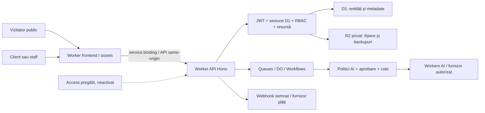

# AVYRON — audit de securitate, calitate și conformitate

Data verificării: 9 noiembrie 2026. Domeniu: `Prometheus1833/avyrontech`, aplicația publică, AVYRON OS, portalul clientului și serviciile native Cloudflare. Audit tehnic, nu certificare sau opinie juridică de conformitate.

## 1. Versiuni, autorizație și interpretarea rezultatelor

- `main` verificat: `7322cf40e09e20b8b6b22a0f18090df574f9f15e`.
- Baza candidatului: `8eccf49ca767a1caff43d74b2cf35aa71a24f62d`, PR #122, pentru reutilizarea întăririlor native ale sesiunilor și pregătirii Access. Acest audit este un PR dependent, fără promovarea implicită a #122 în producție.
- Worker API activ verificat prin Wrangler: versiunea `fcbabe3d-c5e2-432a-bce3-f64d2f93244c`, 100% din deploymentul `ee3d1cfa-f5b4-4405-9ce2-d67efd5a5a5a`, publicat la 8 noiembrie. O versiune încărcată nu este automat versiunea care servește traficul.
- D1 live: 281 tabele, 107 migrații înregistrate, ultima `0109_domain_registrar_source.sql`. Migrarea 0110 din PR #122 **nu a fost aplicată remote**. Auditul nu introduce o migrare nouă.
- PR-uri separate: #123 (Website prin abonament), #124 (SEO/UX, dependent de #123), #125 (Site Builder/proiecte), #126 (cont client) și #110 (cabinet). Existența lor nu dovedește lansarea. Fișierele și workflow-ul cabinetului nu sunt modificate.
- Nicio schimbare de producție, DNS, reguli WAF/Access, abonament, secret, cont, încasare, expediere sau publicare nu a fost executată. Testele negative și restaurările folosesc date sintetice local. Verificările live sunt citiri de configurație/metadate și navigare publică obișnuită.

| Status | Sens exact |
| --- | --- |
| PASS | Control verificat în suprafața și mediul precizate; nu presupune validare pe toate rutele sau în producție. |
| FAIL | Lipsă sau abatere confirmată; nu este automat o exploatare demonstrată. |
| FIXED | Patch aplicat candidatului și verificat; nu înseamnă deploy sau rezolvare retroactivă a incidentelor. |
| NOT_APPLICABLE | Mecanism absent din arhitectura inventariată; se reevaluează dacă este introdus. |
| NOT_VERIFIED | Lipsesc probe suficiente, accesul, dispozitivul sau validarea operațională. |
| ACCEPTED_EXCEPTION | Excepție explicită a utilizatorului; nu echivalează cu îndeplinirea cerinței standardului. |

**Rezultat de conformitate: NOT_VERIFIED. Nu se declară ASVS L2/L3, AAL2, WCAG AA, EN 301 549, EAA, SLSA sau ACS îndeplinite integral.**

## 2. Inventarul infrastructurii și suprafața de atac

[Inventarul inventariat](INFRASTRUCTURE_INVENTORY.json) conține 418 endpointuri explicite, 98 înregistrări middleware și 14 panouri detectate static. Nu toate endpointurile sunt private. Inventarul AST reproductibil este generat cu `npm run audit:security -- --output /tmp/avyron-audit.json`. Include rutele explicite, middleware-urile, panourile și bindingurile, fără a considera simpla existență a unui middleware drept dovadă de autorizare.

| Componentă reală | Dovezi și status |
| --- | --- |
| Website/cont/API | `avyron.ro`, `www.avyron.ro`, `app.avyron.ro`, `api.avyron.ro`; rutare suplimentară Surveys/exemple și `avyron.eu`/subdomenii în `wrangler.jsonc`. DNS/TLS pentru fiecare hostname delegat: NOT_VERIFIED. |
| Worker principal | `avyrontech`: Hono, React/Vite/static assets, autentificare și API; versiune activă verificată mai sus. |
| Worker frontend | `avyron-site`, service binding `API → avyrontech`, `src/worker/index.ts`; configurație verificată, destinația efectivă de producție separat: NOT_VERIFIED. |
| Email | Worker separat în `cloudflare/workers/email`, bindinguri de email și adaptoare native; trimiterea/deliverability nu au fost testate. |
| D1 | `avyron-db`, `avyron-db-preview`; existență live confirmată prin Wrangler, schema live inventariată fără export de date personale. |
| R2 | `avyron-files`, `avyron-media`, două bucketuri distincte pentru backupuri de documente și documente corporative; existență live confirmată. URL-urile gestionate `r2.dev` sunt dezactivate la toate patru. Niciunul dintre cele patru bucketuri nu are domenii custom. Protecția administrării bucketurilor și restaurarea live rămân NOT_VERIFIED. |
| KV | `avyron_kv`, `avyron_kv_preview`: existență live confirmată; cheile/valorile private nu au fost extrase. |
| Queues | `avyron-async-jobs`, DLQ și resurse preview: configurate, cozile AVYRON sunt confirmate în listarea live. Starea livrării fiecărui job nu a fost presupusă. |
| Durable Objects/Workflows | `AvyronAgentRuntime`, `DocumentExportRuntime`, `AvyronMaintenanceWorkflow`: bindinguri și implementări reale, coordonare prin RPC privat; SLA/restore de furnizor NOT_VERIFIED. |
| Workers AI | Binding nativ, registru modele, rezervări/cote în D1, blocare paid/overage implicită; nu s-au executat inferențe sau activat modele plătite. |
| GitHub | Workflow-uri Verify/Security, Dependabot, CodeQL și scanare de secrete pregătită în #122. `main`: `protected=false`, rulesets `[]`, confirmate prin API. Politicile Actions la nivel de cont au răspuns 403: NOT_VERIFIED. |
| Zero Trust/WAF | Pregătirea Access există în #122, fără activare. Creditele OAuth disponibile nu au permis un inventar Access/WAF valid; nu se presupun aplicații/politici absente sau funcționale. API-urile REST directe au răspuns 401/403, un apel Access 429; nu s-au repetat scanări agresive. Wrangler a confirmat separat resursele de mai sus. |
| Integrări comerciale | Stripe, Revolut, Oblio, Resend/email, Google OAuth și adaptoare sociale există în cod. Configurația sau numele unui secret nu dovedește o integrare operațională. Nu s-au emis facturi sau plăți reale. |

Metadatele versiunii active confirmă `ADMIN_MFA_POLICY=disabled`, `MFA_AUTH_ENABLED=false`, `PAID_AI_ENABLED=false`, `ALLOW_AI_OVERAGE=false`, `BACKUP_JOBS_ENABLED=false`; nu au fost activate joburi sau cote plătite. `BOUNCER_API_KEY` nu este prezent; existența secretului Stripe este doar metadată, nu probă de plată funcțională. Registrul D1 are primary Mistral Small 3.1, secondary Gemma 4 și imagine Flux 2 Klein, toate marcate fără billing; nicio inferență reală nu a fost consumată.

Bucketurile backup au doar regula de abandon al multiparturilor incomplete după șapte zile; aceasta **nu șterge obiectele finalizate** și nu dovedește o politică de retenție sau un backup executat. Flagurile de privacy/isolation sunt true în configurație, dar restaurarea operațională rămâne NOT_VERIFIED.

URL alternativ activ: `avyrontech.avyrontech.workers.dev`; `/api/auth/me` a răspuns 401/no-store. Nu a fost dezactivat, deoarece consumatorii legitimi trebuie inventariați înainte. Nu s-a confirmat un proiect Pages separat pentru frontendul principal; configurația Worker/assets este verificată.

PR-urile #123–#126 au fost inventariate separat prin GitHub. Review selectiv: #123 montează gardele native pe rutele internal/account și reutilizează projectAccessMap; #125 validează etapele și păstrează parametrii SQL separați; #126 reconciliază plățile prin userId/granturi. Aceste observații statice nu reprezintă testarea integrată a ramurilor. #124 suprapune o parte dintre ajustările UI/CSS, iar #125 modifică și cfAuth: integrarea trebuie reconciliată și retestată după actualizarea din main, fără pierderea niciunei ramuri. Migrările 0111 și 0112 nu sunt aplicate în acest audit.

Panouri: `src/pages/Profile.tsx`, `/intern`, modulele de proiecte, AI OS, staff, CRM, servicii/produse, abonamente, financiar și Document Center. Rutele sensibile sunt inventariate din API și testate cu principalii nativi; shell-ul HTML al unui SPA nu constituie acces la date.



Granițe: identitatea Cloudflare nu înlocuiește rolul nativ; un client nu devine staff prin ascunderea/afișarea meniului; un ID de document/proiect nu este permisiune; catalogul public și datele contractuale private sunt distincte; un rezultat LLM nu acordă drepturi de execuție.

## 3. Probleme confirmate și remedieri

| ID / prioritate | Status | Problemă, remediere și probă |
| --- | --- | --- |
| AQ-01 importantă | FIXED | `cfAuth.raw/requestResponse` acceptau URL-uri absolute și atașau Bearer inclusiv către furnizori externi. Transportul verifică destinația înainte de refresh: numai originile API/auth configurate, cale `/api/`, fără userinfo/fragment sau port străin. Redirecturile autentificate sunt respinse. `apiBase.ts`, `cfAuth.ts`, `security-audit-regressions.test.ts`. Nu s-a demonstrat un incident istoric. |
| AQ-02 regresie verificată | PASS | Facturile externe erau deja afișate ca linkuri allowlisted `noopener noreferrer`, separat de transportul autentificat. Se explicitează și `referrerPolicy="no-referrer"`; testul browser urmărește cererea reală către un furnizor sintetic și verifică lipsa Bearer/referrer. Nu se raportează o scurgere preexistentă în acest flux. PDF-urile native rămân autorizate prin API. `InvoicesTab.tsx`, `security-audit.spec.ts`. |
| AQ-03 medie | FIXED | Descriptorii KDF acceptau dimensiunea digestului stocat drept dimensiune de ieșire, inclusiv digest gol/foarte scurt în date malformate. Verificarea impune structura, sare 16 bytes și digest 32 bytes, cu limită de dimensiune înainte de KDF. Scrypt și PBKDF2 valide rămân compatibile. Nu reprezintă o ocolire demonstrată fără coruperea/importul hashului. `security.ts`, testele negative și round-trip legacy. |
| AQ-04 medie | FIXED | Acțiuni CI AVYRON pe taguri mutabile: checkout/setup-node/CodeQL sunt fixate la commituri oficiale, tagurile anotate dereferențiate și SHA-urile verificate; checkoutul nu persistă tokenul în configurația Git. Dependabot pentru Actions era deja configurat. Workflow-ul cabinetului rămâne separat, cu taguri: risc rezidual. |
| AQ-05 importantă | FAIL | GitHub `main` fără protecție/ruleset. Patch declarativ **dezactivat**, `main-ruleset.proposed.json`, pregătit pentru review; activarea poate bloca release-uri și necesită aprobare/validarea bypassului de urgență. |
| AQ-06 importantă | ACCEPTED_EXCEPTION | MFA/TOTP/SMS/verificări administrative suplimentare obligatorii nu sunt activate, conform instrucțiunii. ASVS v5.0.0-6.3.3 și asigurarea AAL2 rămân neîndeplinite. |
| AQ-07 importantă | FAIL | Politica de parole nu demonstrează minimum 15 caractere pentru autentificarea cu un singur factor, corpus de parole compromise sau blocklist minim. Nu s-au invalidat parolele administratorilor existenți. UI-ul signup/reset impune și compoziție majusculă/cifră (v5.0.0-6.2.5); politica trebuie reconciliată cu lungimea și blocklist înainte de relaxarea vreunei restricții. Reconcilierea necesită implementare/testare separată. |
| AQ-08 importantă | FAIL | HTML public live fără CSP la verificare; #122 adaugă baseline și script policy report-only. L2 cere restricții de script efective; activarea directă poate afecta editori/3D/plăți. În proba HTTP live, HTML-ul nu avea CSP/HSTS/nosniff/Referrer-Policy; API-ul avea CSP restrictiv și nosniff, dar nu HSTS. Candidatul #122 adaugă headerele HTML; HSTS din candidat fără `includeSubDomains` nu satisface cerința completă. Inventariați toate subdomeniile înaintea extinderii. |
| AQ-09 importantă | NOT_VERIFIED | Nu există dovadă nouă de cont Bouncer/DPA aprobat, scanare reală sau restaurare de producție. Carantina/fail-closed se testează sintetic; nu se declară protecție antivirus live sau conformitate transferuri. |
| AQ-10 medie | FAIL | JWT-ul nativ nu are contract explicit de audience: v5.0.0-9.2.3. Semnătura, expirarea și sesiunea live sunt verificate; separarea issuer/audience necesită rollout compatibil, fără invalidarea accidentală a sesiunilor existente. |
| AQ-11 medie | NOT_VERIFIED | Reautentificarea, lifetime-ul/inactivitatea și păstrarea sesiunilor privilegiate nu sunt o dovadă AAL2/L3. Nu se introduc pași obligatorii noi; riscul de sesiune furată rămâne explicit. |
| AQ-12 importantă | FIXED | Probleme comune de lizibilitate și reflow: tokenul brand în tema light, CTA-uri verde/cyan, fundalul bibliotecii, contrastul textelor secundare, linkuri în text, structura dl, controale blog și zone derulabile din tastatură. `index.css`, paginile Blog/Gdpr/CookiePolicy/Configurator, biblioteca, Primitives/Collection/Guide, ServicePage/QA și PaymentMethods. Progresul și problemele rămase sunt raportate numeric; nu se acordă WCAG AA global. |
| AQ-13 importantă | FAIL | Performanța mobilă necesită optimizare suplimentară: măsurare finală 71, LCP 4,35 s, TBT 560 ms. Patch parțial: showcase-ul se montează aproape de viewport; ancora, HTML-ul prerandat, conținutul și încărcarea prin focus de tastatură sunt păstrate. Scena cinematică nu este eliminată. Nu se declară obiectivul de performanță îndeplinit. |
| AQ-15 medie | FAIL | Proba de regresie `logo3d-refinement` WebKit mobil nu poate finaliza exportul în mediul software WebGL. Diagnosticul separat confirmă pierderi repetate de context WebGL și fallback activ; cauza pe dispozitive reale este NOT_VERIFIED. Chromium și fallback-ul fără WebGL sunt testate separat. Nu se omit probele și nu se declară întreaga suită browser PASS. |
| AQ-16 importantă | FAIL | Schedulerul nativ de backup nu este activ în versiunea de producție (`BACKUP_JOBS_ENABLED=false`). Existența bucketurilor și a checksumurilor nu demonstrează protecția operațională. Copiile externe/manuale, dacă există, sunt NOT_VERIFIED. Nu se activează joburi sau retenții automat; este necesară o restaurare izolată și validarea cotelor înainte de activare. |
| AQ-14 importantă | FAIL | Work factor nativ scrypt `N=16384,r=8,p=1` sub recomandarea OWASP curentă pentru v5.0.0-11.4.2. La același N, ghidul indică p=5 ca alternativă cu memorie redusă; PBKDF2 legacy 100k este păstrat numai pentru compatibilitate. Nu se mărește costul CPU fără benchmark Workers/concurență și rollout cu citirea ambelor formate. `security.ts`; [ghid oficial](https://cheatsheetseries.owasp.org/cheatsheets/Password_Storage_Cheat_Sheet.html). |

Nu s-au identificat prin aceste verificări o exploatare critică confirmată sau o scurgere istorică. Această constatare nu exclude vulnerabilități neobservate.

## 4. Matricea ASVS 5.0.0 și obiectivul L2/L3

[ASVS_5_0_0_MATRIX.csv](ASVS_5_0_0_MATRIX.csv) include **toate cele 345 cerințe oficiale**, dintre care 253 au nivel L1/L2 și 92 nivel L3. Obiectivul L2 include L1. L3 este analizat suplimentar pentru identitate, autorizare, criptografie, date și loguri, nu declarat realizat.

Catalogul [asvs-5.0.0-catalog.json](asvs-5.0.0-catalog.json) păstrează ID, nivel, secțiune și checksum pentru fiecare definiție. Sursa oficială este tagul `v5.0.0`; SHA-256 CSV: `98c8fe911b9edb403af8ee05d3ce8201ecac2659e313b053890a62847cdcf680`. Textul normativ se consultă în sursă; nu au fost inventate identificatoare. `audit:security` verifică referințele, unicitatea și statusurile, **nu certifică îndeplinirea lor**.

Exemple: v5.0.0-3.3.1/3.3.2/3.3.3/3.3.4 (cookie nativ), v5.0.0-7.2.1/7.2.3 (verificare/entropie), v5.0.0-7.4.1 (revocare), v5.0.0-9.1.1/9.1.2/9.2.1 (integritate/validitate JWT) au probe locale explicite. v5.0.0-8.2.2/8.4.1 au scenarii BOLA/izolare în testele de module, dar nu se extinde PASS la fiecare resursă fără verificare exhaustivă. v5.0.0-5.4.3 cere scanare efectivă a fișierelor externe: probele sintetice nu substituie furnizorul live.

GraphQL, WebRTC/TURN și rolurile OAuth authorization server/OpenID Provider sunt NOT_APPLICABLE pentru arhitectura actuală. Clientul OAuth Google este relevant și nu este scos din audit prin această clasificare. Cerințele neprobate rămân NOT_VERIFIED; nu sunt presupuse PASS din simpla prezență a codului.

## 5. Maparea OWASP și verificarea modulelor

| OWASP Top 10:2025 | Evaluare și dovezi |
| --- | --- |
| A01:2025 Broken Access Control | Teste de client A/B, proiect, staff, owner/superadmin, Documente SC, facturi și revocare; `workspace-runtime`, `document-center`, `platform-owners-runtime`. PASS în scenariile locale; configurația live per rol NOT_VERIFIED. |
| A02:2025 Security Misconfiguration | FAIL: CSP/HSTS complet, protecția `main`; Access/WAF NOT_VERIFIED. |
| A03:2025 Software Supply Chain Failures | FIXED: pinuri CI; SCA fără advisories la data rulării. Provenance NOT_VERIFIED. Istoricul `origin/main` a fost scanat și potrivirile au fost triate, fără a considera scanarea dovadă de absență a oricărui secret. |
| A04:2025 Cryptographic Failures | FIXED: descriptor KDF; work factor FAIL față de ghidul curent; lifecycle criptografic complet NOT_VERIFIED. |
| A05:2025 Injection | SQL parametrizat, sanitizare editor/blog și SSRF în testele existente; nu se revendică excluderea tuturor sinkurilor. |
| A06:2025 Insecure Design | Inventar, threat boundaries, aprobări umane și cote; maturity organizațională NOT_VERIFIED. |
| A07:2025 Authentication Failures | Excepție MFA, gap parole și audience; sesiuni native testate local. |
| A08:2025 Software or Data Integrity Failures | Semnături webhook, idempotency și checksum backup testate sintetic; verificarea furnizorilor reali NOT_VERIFIED. |
| A09:2025 Security Logging and Alerting Failures | Audit DB/CSP bounded și request IDs există; ingestie, retenție, alerte și exercițiu de incident live NOT_VERIFIED. |
| A10:2025 Mishandling of Exceptional Conditions | Teste de indisponibilitate DB/R2/furnizor, fail-closed și retry; nu se simulează indisponibilitate în producție. |

API Security 2023: API1:2023/API3:2023/API5:2023 → RBAC, BOLA și câmpuri administrative; API2:2023 → sesiuni/parole; API4:2023/API6:2023 → cote, body limits și operațiuni comerciale; API7:2023 → SSRF; API8:2023 → headere/configurație; API9:2023 → inventarul de rute; API10:2023 → adaptoare și transportul sigur al facturilor. Acestea sunt mapări de risc, nu zece certificări PASS.

| Suprafață | Probe urmărite |
| --- | --- |
| Dashboard/staff/CRM/proiecte | `workspace-runtime`, `platform-owners-runtime`, `os-dashboard-runtime`, `lead-follow-up-review-runtime`: granturi, mass assignment, acțiuni și câmpuri per rol. |
| Clienți/servicii/abonamente | `client-portal`, `subscription-operations-runtime`, `service-pages-runtime`, catalogul și selecția contului autorizat. |
| Document Center/AVY Center | `document-center`, `document-experience`, `overview-actions-runtime`: publicare explicită, versiuni nemodificabile, export, share, SC și revocare. |
| Plăți/produse/AVY Studio | `finance-commerce-runtime`, `billing-methods`, `produse-*`: semnături, cantități/sume, ownership, retry și entitlement după confirmare. Fără tranzacții reale. |
| Configurator/Surveys/formulare | Validare server, limite, antispam, upload; teste `survey-public-runtime`, `contact-forms-runtime`, `social-forms-surveys-store-content`. |
| Monitorizare/backup | Configurații private, checksum manifest și restaurare ca versiune nouă în `document-center`; fără restaurare live sau export de date private. |

Scenarii WSTG 4.2 verificate din paginile oficiale: [WSTG-ATHZ-04](https://wstg.owasp.org/v4.2/4-Web_Application_Security_Testing/05-Authorization_Testing/04-Testing_for_Insecure_Direct_Object_References/) → obiecte client A/B, proiecte și documente în testele locale; [WSTG-SESS-05](https://wstg.owasp.org/v4.2/4-Web_Application_Security_Testing/06-Session_Management_Testing/05-Testing_for_Cross_Site_Request_Forgery/) → origin/CSRF în Worker nativ local; [WSTG-ATHN-03](https://wstg.owasp.org/v4.2/4-Web_Application_Security_Testing/04-Authentication_Testing/03-Testing_for_Weak_Lock_Out_Mechanism/) → limiter/backoff în teste, fără blocarea vreunui cont real. Aceasta nu reprezintă executarea tuturor scenariilor WSTG.

## 6. Agenți AI: LLM 2026, Agentic 2026 și ACS

LLM 2026 este luat din sursa canonică oficială `GenAI-Security-Project/GenAI-LLM-Top10`, `2026/final`, commit `9253e38ade58e959b531c0c5c9a4842272c9cd0e`; pagina veche de navigare încă afișează lista 2025. Numerotările nu se amestecă.

| LLM 2026 | Evaluare |
| --- | --- |
| LLM01 Prompt Injection | Contextul este separat de instrucțiuni; datele publice aprobate sunt filtrate. Rezistența semantică adversarială pe model real: NOT_VERIFIED. |
| LLM02 Sensitive Information Disclosure | Filtre tenant/public, graniță transport FIXED; red-team pe conversații reale NOT_VERIFIED. |
| LLM03 Excessive Agency | Public chat execută retrieval, nu shell/arbitrary URL. Aprobările reale de publicare/plată sunt server-side; niciun test nu aprobă conținut prin răspuns LLM. |
| LLM04 Supply Chain | Model registry, aliasuri de migrare, pinuri CI; proveniența internă a greutăților furnizorului NOT_VERIFIED. |
| LLM05 Data and Model Poisoning | Surse publice aprobate și versiuni; evaluare asupra unui corpus malițios real NOT_VERIFIED. |
| LLM06 Unbounded Consumption | Rezervări atomice D1, limite de output, cote Free și kill switch; facturile reale/contorizarea externă/replay provider NOT_VERIFIED. |
| LLM07 Misinformation | Nu se promit prețuri/obligații create de model; surse comerciale native. Corectitudinea tuturor răspunsurilor NOT_VERIFIED. |
| LLM08 Hidden Context Exposure | Nu se pun implicit documente SC/client în RAG public. Izolarea contextului este testată sintetic, nu prin publicarea de date reale. |
| LLM09 Vector and Embedding Weaknesses | Niciun binding Vectorize activ în configurația inventariată; FTS D1 nu este vector store. Vector retrieval: NOT_APPLICABLE în acest candidat. |
| LLM10 Improper Output Handling | Outputul nu este evaluat ca JS/SQL/shell; HTML editor/import este sanitizat. Toate ieșirile custom viitoare necesită revalidare. |

Agentic 2026: ASI01 Agent Goal Hijack; ASI02 Tool Misuse & Exploitation; ASI03 Identity & Privilege Abuse; ASI04 Agentic Supply Chain Vulnerabilities; ASI05 Unexpected Code Execution; ASI06 Memory & Context Poisoning; ASI07 Insecure Inter-Agent Communication; ASI08 Cascading Failures; ASI09 Human-Agent Trust Exploitation; ASI10 Rogue Agents. Media/Social, Leads și AI OS sunt urmărite prin `aiCore`, `aiCostGuard`, `aiProjects`, `socialStudioScheduler`, `knowledgeRetrieval`, `agentRuntimePolicy`, logurile/versionarea și testele aferente.

Important: `evaluateAgentAction` este un helper de politică; testarea sa nu demonstrează că fiecare flux îl invocă. Enforcementul real trebuie demonstrat pe routerul, versiunea și acțiunea concretă. Apelurile cloud model au fost simulate, fără tokenuri/imagini/mesaje externe sau costuri noi. Nu există probă completă împotriva prompt injection, poisoning sau buclelor în fiecare agent live.

ACS v0.1.4 (Instrument/Trace/Inspect) este referința verificată. Identitățile scoped, hooks, audit trail și inventarul agenților sunt evaluate conceptual. Interoperabilitate wire-format Guardian/ACS, AgBOM și conformance profile: **NOT_VERIFIED**; nu se introduce un serviciu Guardian suplimentar și nu se revendică implementarea ACS dintr-un simplu approval flag.

## 7. WCAG 2.2 AA, SEO, UX și performanță

- Evaluarea automată folosește axe-core, tastatură și viewport-uri în Chromium/WebKit. Criterii relevante: 1.1.1, 1.3.1, 1.4.3, 1.4.4, 1.4.10, 2.1.1, 2.1.2, 2.3.3 (AAA, referință suplimentară), 2.4.3, 2.4.7, 2.4.11, 2.5.8 și 4.1.2. Nu se consideră toate criteriile AA trecute doar pentru că axe nu raportează probleme.
- Modelele publice, formularele, clientul și stafful sunt verificate prin suitele browser. Desktop/mobile sunt emulări, nu test fizic iPhone/Android. VoiceOver/NVDA și ordinea anunțurilor cu cititor real: NOT_VERIFIED.
- Lighthouse oferă măsurători lab, nu percentila 75 din CrUX și nu INP din trafic real. Profilul DevTools partajat era ocupat; măsurarea utilizează Chrome izolat, fără oprirea browserelor utilizatorului.
- `build:pages`/`build:worker` verifică canonicals, sitemap, robots, metadate și structured data pe registrul public. Acest lucru nu demonstrează indexarea Google/Bing sau trafic. Conturile GSC/Bing și ratele reale de conversie nu au fost accesate.
- Designul cinematic GSAP/Three.js este păstrat. Nu se elimină scena, animația sau efectele pentru a ascunde costul lor în scoruri. Reduced motion, focus și stările recuperabile sunt testate separat.
- EN 301 549 v3.2.1, clauza 9, este referință pentru web; nu este echivalentă automat cu toate cerințele WCAG 2.2. Aplicabilitatea EAA/Directiva (UE) 2019/882, inclusiv domeniul comercial și posibilele excepții, este NOT_VERIFIED fără date organizaționale și evaluare juridică.

Rezultatele automate sunt documentate mai jos; verificările manuale complete nu sunt înlocuite cu scoruri sau estimări.

## 8. NIST, OpenSSF, SLSA și SAMM

| Referință | Evaluare |
| --- | --- |
| SSDF 1.1 PO.1 / PO.2 / PO.4 | Cerințe, responsabilități și criterii în repository; instruirea și adoptarea organizațională NOT_VERIFIED. |
| SSDF PO.3 / PO.5 | CI cu privilegii reduse și medii separate; protecția ramurii FAIL, politicile contului NOT_VERIFIED. |
| SSDF PS.1 / PS.2 / PS.3 | Git, lockfiles și pinuri FIXED; verificare provenance/semnături/retention completă NOT_VERIFIED. |
| SSDF PW.1 / PW.2 / PW.4 / PW.5 | Threat map, control de acces, review și SCA; nu se presupune acoperirea completă a componentelor terțe. |
| SSDF PW.6 / PW.7 / PW.8 / PW.9 | Build, SAST/CodeQL în CI, testare și configurații; constatări/rulări exacte mai jos, fără echivalare cu certificare. |
| SSDF RV.1 / RV.2 / RV.3 | Dependabot, proces repetabil și patchuri; SLA incident, root-cause la nivel de organizație și exercițiu complet NOT_VERIFIED. |
| CSF 2.0 GOVERN / IDENTIFY | Inventar și risc rezidual prezente; ownership/acceptări formalizate și asset inventory extern complet NOT_VERIFIED. |
| CSF PROTECT / DETECT | Controale locale și telemetrie; excepția MFA și lipsa probei alertării live rămân explicite. |
| CSF RESPOND / RECOVER | Runbook și restaurare sintetică; exercițiu operațional de incident și RTO/RPO live NOT_VERIFIED. |
| OpenSSF Scorecard | SCA, SAST, code review și pinning analizate. Branch-Protection FAIL, Pinned-Dependencies incomplet pentru workflow-ul cabinetului exclus. Nu se inventează un scor oficial Scorecard. |
| SLSA | Se utilizează specificația curentă 1.2; build CI existent nu dovedește provenance semnată sau nivel Build L1/L2/L3. NOT_VERIFIED. |
| OWASP SAMM | Governance, Design, Implementation, Verification, Operations acoperite prin evidențe; fără evaluare organizațională nu se acordă scor de maturitate. |

## 9. Proces repetabil, teste și rezultate

Comenzi sigure, fără deploy sau migrare remote:

```sh
npm run audit:security -- --output /tmp/avyron-security-inventory.json
npm run typecheck
npm run lint
npm audit --audit-level=high
npm audit --prefix cloudflare/workers/api --audit-level=high
npm run audit:d1
npm run test:security:local
npm run test:security:browser-cookie
node scripts/test-browser-cookie-wire.mjs webkit
SERVICE_CONTENT_SNAPSHOT_SKIP=1 npm run build:pages
npm test
npm run test:e2e
SERVICE_CONTENT_SNAPSHOT_SKIP=1 npm run build:worker
npm run build:api
npm run build:email
```

`audit:security` verifică inventarul și integritatea referințelor, nu este un certificat. Runnerul nu are mod de apply/deploy. Nu folosiți `deploy`, `scripts/release-api.mjs`, aplicarea migrațiilor remote sau schimbarea flagurilor ca și cum ar fi teste locale.

Rezultate de bază verificate:

- SCA: `npm audit` pe root și API — 0 advisories la data verificării. Nu este o garanție pentru vulnerabilități încă nepublicate.
- Scanare arbore Git: 0 constatări după reguli de secret-hygiene. Gitleaks **v8.30.1**, binar din release oficial cu checksum verificat, a parcurs 1.247 commituri din `origin/main` (17,23 MB). Cele șapte potriviri au fost triate: patru chei de cache/localStorage, două fixture-uri sintetice/RFC, o cheie publică legacy Supabase cu rol `anon`. Nicio cheie privilegiată confirmată prin aceste rezultate; fără allowlist global care să ascundă viitoare rezultate. Starea vechiului backend/RLS nu a fost interogată și rămâne NOT_VERIFIED. Nu se rescrie istoricul Git și nu se rotește o integrare activă fără inventarul consumatorilor.
- Runtime nativ: **394 verificări HTTP trecute**, dintre care 364 combinații metodă/rută privată refuză accesul anonim. Celelalte verifică sesiuni, owner/client, seed, CSRF/CORS, refresh, revocare și izolarea sesiunii celuilalt client. D1 dispensabil, conturi sintetice, Worker real local; nu un mock al funcției requireAuth. Acoperirea anon-denial nu demonstrează automat toate combinațiile de rol/resursă.
- Teste unitare/integrare: rularea completă inițială a avut 130 fișiere trecute, 1.160 teste trecute, unul skipped, un timeout de test AI sub încărcare și un fișier de evidențe în mediul greșit. Fișierul de evidențe a fost corectat la mediul Node. Reluarea izolată a celor două fișiere plus regresiile noi: **26/26 trecute**, inclusiv testul AI expirat; suita țintită auth/transport/boundary: **50/50 trecute**. Nu este prezentată rularea inițială drept complet verde. **Reluarea completă finală cu un singur worker: 132/132 fișiere PASS, 1.166 teste PASS și 1 skipped din 1.167; 822,19 s.**
- Format parole live: doar agregate citite (fără hashuri/parole), 12 înregistrări native scrypt de lungime 86, compatibile cu noul validator; round-trip scrypt/PBKDF2 valid și digesturi malformate testate local.
- Regresiile noi pentru transport/KDF și integritatea referințelor: **20/20 PASS**; include digest base64 gol după decodificare, descriptor extins și port/origine externe.
- Typecheck app/Worker, lint, D1 local și dry-run Worker API/email: PASS. Lint are patru avertismente Fast Refresh preexistente, fără erori.

Axe: prima trecere mobilă, 289 rute, **215 PASS / 74 FAIL**. După remedierea surselor comune: **271 PASS / 18 FAIL**, fără overflow pe nicio rută dintre cele 289. După verificările țintite finale, [PUBLIC_ACCESSIBILITY.csv](PUBLIC_ACCESSIBILITY.csv) consolidează **289 PASS / 0 FAIL / 0 NOT_VERIFIED** pentru capturile rutei. CSV indică checkpointul fiecărei probe: sweep complet urmat de reverificarea suprafețelor corectate, nu un nou sweep complet al tuturor stărilor. Aceste cifre descriu captura DOM verificată, cu API-uri publice sintetice și fără consimțământ analytics/marketing. Nu verifică fiecare stare interactivă, fiecare element încărcat ulterior sau datele CMS live. Testele browser, măsurătorile Lighthouse și buildurile finale sunt înscrise în evidența de livrare.

Proba independentă `test-browser-cookie-wire.mjs` a confirmat în Chromium și WebKit: cookie-ul HttpOnly este trimis pe conexiunea HTTP locală între origini de același site și nu poate fi citit din document.cookie. În WebKit, antetele interceptate de Playwright nu includ Cookie, deși serverul îl primește; fixture-ul de autentificare citește cookie jar-ul, separat de această probă reală de transport. Fluxul sintetic Safari cont → Logo Studio → serviciu → reload a trecut după corectarea fixture-ului. Aceasta nu este o probă de autentificare într-un cont real sau un test al tuturor politicilor ITP/HTTPS pe subdomeniile live.

Secret scanning este euristic; CodeQL nu substituie un pentest. Nu s-au trimis EICAR/malware, parole, documente confidențiale sau date de plată către furnizori. Nu s-au exercitat volum, brute-force sau DAST activ împotriva producției. Dispozitivele fizice, screen readers, probele autentificate live, Access/WAF, DPA, scanarea Bouncer și restaurarea de producție rămân explicit NOT_VERIFIED.

### Builduri și verificări finale locale

| Verificare | Status / rezultat |
| --- | --- |
| Build static și Cloudflare Pages | PASS; snapshotul de conținut public din Git este folosit explicit, fără a modifica datele live. |
| Build Worker frontend separat | PASS; artefact Worker și prerandare generate, audit SEO: 78 pagini indexabile, 212 rute publice noindex, 11 URL-uri strategice de produse. Nu este dovadă de indexare în motor. |
| Worker API și email | PASS, dry-run; nicio publicare. |
| Typecheck aplicație și Worker | PASS. |
| Lint | PASS, zero erori și patru avertismente Fast Refresh existente. |
| D1 local | PASS, fără aplicare remote. |
| Inventar / referințe ASVS / scanare fișiere pregătite | PASS, zero erori de referință și zero potriviri de secrete în regulile verificate. |
| Staging Cloudflare autentificat, roluri live și CodeQL remote | NOT_VERIFIED la redactare; rezultatele CI se verifică pe SHA-ul exact al PR-ului, nu prin existența workflow-ului. |

### Dovezi browser și limite de livrare

Suitele Chromium și WebKit/iPhone 13 au fost rulate pe buildul local de producție, cu API-uri sintetice și un singur worker pentru limitarea presiunii pe resurse. Prima rulare a fost întreruptă la presiune de memorie: 217 PASS, un timeout și patru întreruperi; 200 probe neafectate au fost păstrate pentru reluarea selectivă. Reluarea celor 566 probe a produs 529 PASS / 37 FAIL. După corectarea fixture-urilor (layout desktop testat la viewport desktop, navigare mobilă reală, cookie jar WebKit și charset UTF-8), reluarea celor 37 a produs 32 PASS / 5 FAIL. Reluarea țintită pentru ancore/intro/footer a produs 5 PASS / 1 FAIL; unele probe sunt repetate, deci aceste numere nu se însumează ca teste distincte.

Reluarea finală intro, după izolarea consimțământului necesar și așteptarea tranziției CSS reale, a trecut **2/2** în Chromium și WebKit. Problema deschisă AQ-15 este exportul WebGL WebKit; nu a fost transformată în skip sau PASS. Nu există încă un verdict complet verde al suitei browser. Testele de siguranță noi pentru factura externă, tastatura caruselului și focusul secțiunilor amânate au trecut **6/6** în ambele motoare, inclusiv citirea antetelor complete ale cererii către furnizorul sintetic. Formularele PF/PJ au fost corectate la tastatură text pentru identificatorul fiscal, care poate conține prefixul RO; fluxul signup WebKit a trecut după corecție.

Serviciile de preview și contextele browser create de audit sunt închise după probe. Nu sunt închise browserele utilizatorului. Nu există preview autentificat Cloudflare sau test pe dispozitiv fizic în această livrare.

### Dovezi finale de performanță și limite

[PERFORMANCE_EVIDENCE.json](PERFORMANCE_EVIDENCE.json) păstrează parametrii și rezultatele, fără date de cont. Lighthouse 13.6.0, localhost, build de producție:

| Profil final, Chrome 156 | Performanță | Accesibilitate | Best practices | SEO | LCP | TBT | CLS |
| --- | ---: | ---: | ---: | ---: | ---: | ---: | ---: |
| Mobil simulat, 412×823, CPU 4×, throttling simulat | 71 | 100 | 96 | 100 | 4,35 s | 560 ms | 0 |
| Desktop | 97 | 100 | 96 | 100 | 1,10 s | 105 ms | 0 |

Baseline-ul în Chrome 151 a avut 41 mobil / 97 desktop. Versiunile de motor diferă, deci delta nu este prezentată drept experiment cauzal controlat. O reluare Chrome 151 a devenit nereactivă; reluarea headless-shell a returnat `NO_LCP`, fără scor valid de performanță. Acestea nu au fost transformate în PASS sau scor zero. Scorul 100 axe/Lighthouse nu acoperă manual toate criteriile WCAG.

**Risc rămas FAIL:** bootup și main-thread pe mobil, LCP peste obiectiv; necesită profilare suplimentară pe dispozitiv, buget DOM/JS și încărcare progresivă, păstrând scenele. INP/CrUX, trafic real, dispozitive iOS/Android fizice și rată de conversie: NOT_VERIFIED.

## 10. Acțiuni care necesită validare/aprobare separată și rollback

1. Review și integrare #122, test în preview izolat cu migrarea 0110, apoi acest PR. Migrarea remote și deployul se aprobă explicit; această ordine păstrează citirea sesiunilor existente.
2. Regula GitHub propusă este `disabled`; verificați numele exacte ale checkurilor și un acces de urgență auditat înainte de activare. Rollback: dezactivarea rulesetului exact, fără force push.
3. Access/WAF/URL-uri alternative: inventar autorizat, politici fără MFA obligatoriu, test client/staff/automatizări, pilot și revenire la configurația anterioară. Nu dezactivați workers.dev înainte de identificarea integrărilor legitime.
4. HSTS subdomenii și CSP enforce: observație/telemetrie, test editori/export/plăți/3D, apoi aprobare. Nu activați HSTS preload sau blocări globale automat.
5. Bouncer: cont/cheie Free și condiții de procesare/DPA aprobate înainte de fișiere confidențiale. Test real numai cu fișier sintetic autorizat; carantina rămâne fail-closed.
6. Backup: restaurați într-o destinație privată izolată, cu checksum, metadate, granturi și fișiere; verificați RTO/RPO și retenția. D1 Time Travel nu substituie copia R2.
7. Chei: identificați proprietarii și consumatorii, creați cheie nouă în secret store, validați preview, rotiți cu fereastră controlată, revocați vechea cheie după probe. Nu rotiți secrete active fără plan pentru webhook-uri și agenți.
8. KDF/parole: patch propus — whitelist strict pentru descriptorul curent și un descriptor nou, emiterea formatului nou numai după benchmark Workers (CPU, memorie și atac de concurență), upgrade oportunist după autentificare validă, fără reset forțat. Pentru JWT, emitere și verificare issuer/audience în pilot cu perioadă de compatibilitate cel puțin egală cu lifetime-ul tokenurilor vechi, apoi enforcement. Ambele necesită teste de integrare și validarea bugetului înainte de activare.
9. Rollback cod: revenire la versiunea Worker/commitul anterior, păstrând schema aditivă. Fără down-migration, ștergere de sesiuni sau date oficiale în masă.

## Surse oficiale

- [OWASP ASVS 5.0.0, CSV oficial](https://github.com/OWASP/ASVS/blob/v5.0.0/5.0/docs_en/OWASP_Application_Security_Verification_Standard_5.0.0_en.csv), CC BY-SA 4.0, OWASP Foundation.
- [OWASP Top 10:2025](https://top10.owasp.org/2025/), [API Security 2023](https://api-security.owasp.org/editions/2023/en/0x11-t10/), [WSTG 4.2](https://wstg.owasp.org/v4.2/).
- [NIST SSDF 1.1 / SP 800-218](https://csrc.nist.gov/pubs/sp/800/218/final), [CSF 2.0](https://www.nist.gov/cyberframework), [SP 800-63B-4](https://pages.nist.gov/800-63-4/sp800-63b/authenticators/).
- [WCAG 2.2](https://www.w3.org/TR/WCAG22/), [EN 301 549 și armonizare](https://digital-strategy.ec.europa.eu/en/policies/web-accessibility-directive-standards-and-harmonisation), [EAA — Directiva 2019/882](https://eur-lex.europa.eu/eli/dir/2019/882/oj).
- [LLM Top 10 2026, sursă canonică](https://github.com/GenAI-Security-Project/GenAI-LLM-Top10/tree/9253e38ade58e959b531c0c5c9a4842272c9cd0e/2026/final), [Agentic Top 10 2026](https://genai.owasp.org/resource/owasp-top-10-for-agentic-applications-for-2026/), [ACS](https://owaspacs.org/docs/acs/).
- [OpenSSF Scorecard](https://scorecard.dev/), [SLSA 1.2](https://slsa.dev/spec/v1.2/), [OWASP SAMM](https://owaspsamm.org/model/), [GitHub secure use](https://docs.github.com/en/actions/reference/security/secure-use), [Cloudflare Workers best practices](https://developers.cloudflare.com/workers/best-practices/workers-best-practices/).


## Reconciliere de lansare — acces financiar, 09.11.2026

**AQ-17 — FIXED în candidatul de lansare.** Registrul agregat de facturare permitea accesul unui Staff fără capabilitatea financiară distinctă, iar reîncercarea facturilor verifica rolul general și MFA fără `finance.write`. `billing.ts` cere acum `finance.read` pentru Staff și principal de platformă sau `finance.write` pentru reîncercare. Citirea rolului Admin rămâne compatibilă cu politica nativă a modulului Financiar. Testul cu SQLite migrat acordă și revocă permisiunile și verifică refuzul la cererea imediat următoare.

Politica financiară comună permite excepția numai când `MFA_AUTH_ENABLED=false` este explicit sau factorul este efectiv verificat; configurația absentă/invalidă ori înscrierea opțională nu o înlocuiesc. Starea `mfaVerified` nu este falsificată. Excepția MFA acceptată, aprobările comerciale/fiscale, verificarea identității procesatorului și limitele de asigurare din raport rămân valabile. Probe: `finance-commerce-runtime.test.ts`, `billing-dashboard.test.ts`, `billing-mfa-policy.test.tsx`, `subscription-operations-runtime.test.ts`; fără încasări, facturi sau mesaje reale.
